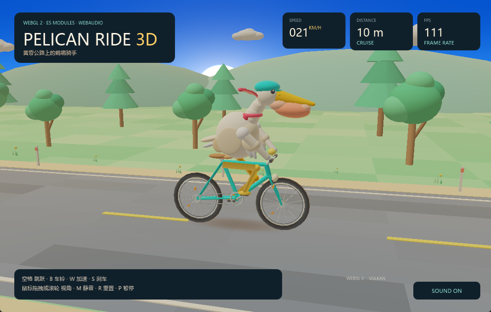

# 这可能是今年最让JS开发者激动的事情了



上面是我用JS+HTML+WebGL2做的鹈鹕3D骑自行车，FPS也非常不错。

你可能会说“这不是用Ai有手就行了么？”

但是，如果我说我把这上面用xbintsc编译成原生二进制，还不到10MB,还能在没有WebView环境上跑，还能支持Node.js和HTML混写，如下：

```html
<html>
    <body>
    <div id="out">loading...</div>
    <script lang="ts">
        import { readFileSync } from "fs";

        const out = document.getElementById("out");
        const world = readFileSync("data.txt", "utf8");
        out.textContent = "hello " + world;
    </script>
    </body>
</html>
```

要知道以前光chrome最少也得有100MB，用xbintsc编译产物10MB还不需要WebView环境，这可不仅仅代表桌面端开发体积极大减小和更加正确的实现路径的问题。

更加具有划时代意义的是，JS开发者在嵌入式设备跑你想要做的应用成为了可能。

[xbintsc开源地址](https://github.com/zy445566/xbintsc)


