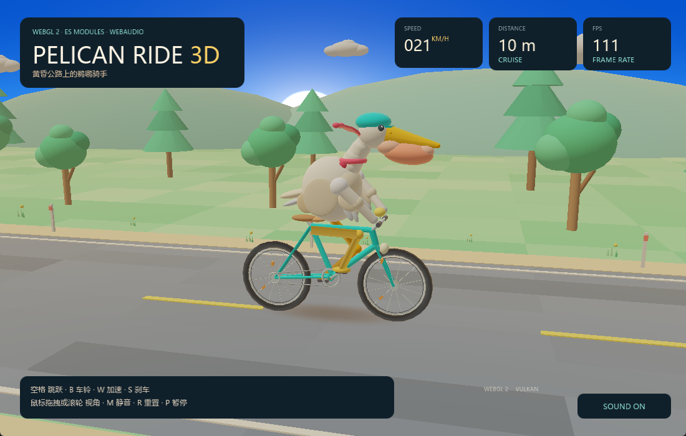

# 鹈鹕骑单车 3D · Pelican Ride 3D



黄昏的海边公路上，一只戴头盔的鹈鹕骑着自行车向前赶路。整个场景是一套
**手写的低多边形 3D 演示**：没有贴图、没有 three.js，几何体、光照、雾、
阴影和动画都在 `js/` 里生成；骑车的动作、车铃和风声则由 **Web Audio
AudioContext** 实时合成。

渲染器有两份实现，页面右下角的按钮（或 `G` 键）可以在 **WebGL 2** 和
**WebGPU** 之间实时切换：

- `js/renderer-webgl.js` —— `#version 300 es` 的 GLSL、VAO、实例化绘制；
- `js/renderer-webgpu.js` —— `navigator.gpu` + WGSL、动态 uniform 偏移、
  `stepMode: "instance"` 的实例化绘制。

两份渲染器暴露同一组方法（`createMesh` / `begin` / `drawSky` / `draw` /
`drawInstanced` / `drawShadow` / `end`），所以 `js/main.js` 里的场景代码
完全不区分后端。

页面本身是一个普通浏览器页面：`index.html` 通过真正的
`<script type="module">` 加载 `js/main.js`，后者用 `import` 拉起其余模块。
xbintsc 的 `gui` 扩展会读取同一份 HTML，把模块图提前编译成本地代码，
再在窗口里加载并渲染。因此同一套源码可以在浏览器和原生窗口里运行。

## 运行

### 浏览器

ES module 不能从 `file://` 可靠加载（Chrome 会按 CORS 拒绝），在示例目录起一个
本地静态服务器即可：

```bash
cd examples/gui/pelican-3d
npx serve .                 # 或者 python -m http.server 8000
```

然后打开终端里给出的地址。默认使用 WebGL 2；加上 `?backend=webgpu`
可以直接用 WebGPU 启动（需要浏览器支持 `navigator.gpu`），进入页面后也可以
点右下角按钮切换。

浏览器要求先有一次点击或按键才会真正启动 AudioContext，所以第一次进入页面后
点一下画面或按任意键即可听到声音。

### 原生窗口

在仓库根目录执行（`xbintsc.config.json` 已经声明了 `gui` 扩展）：

```bat
set xbintsc_CLANG=C:\Program Files\Microsoft Visual Studio\2022\Community\VC\Tools\Llvm\x64\bin\clang.exe
npx tsx src/cli/main.ts run examples/gui/pelican-3d/main.ts
```

构建独立可执行文件：

```bat
npx tsx src/cli/main.ts build examples/gui/pelican-3d/main.ts --out examples/gui/pelican-3d/build
examples\gui\pelican-3d\build\main.exe
```

原生窗口会自动启动音频；`main.ts` 只负责开窗、加载页面和打印一份
`label=value` 报告，动画与渲染都在模块里。设置
`XT_GUI_AUTOCLOSE_MS=<毫秒>` 可以让窗口在指定时间后自动关闭，方便冒烟测试。

## 操作

| 输入 | 动作 |
| --- | --- |
| `Space` / `↑` | 跳跃（翅膀会张开，落地有音效） |
| `B` | 按车铃（合成钟声） |
| `W` / `→` | 加速（风声变强） |
| `S` / `←` | 刹车 |
| 鼠标拖拽 | 绕骑手旋转视角 |
| 滚轮 | 拉近 / 拉远 |
| `G` 或右下角按钮 | 在 WebGL 2 与 WebGPU 之间切换渲染后端 |
| `M` | 静音 / 恢复 |
| `R` | 重置里程和速度 |
| `P` | 暂停 / 继续 |

## 文件结构

```
index.html             页面骨架 + 两个 <canvas> + HUD + 后端切换按钮
main.ts                原生宿主：createWindow / loadHTML / run / 报告
xbintsc.config.json    entry + gui 扩展
js/main.js             启动、输入、相机、帧循环、HUD、关节动画、后端切换
js/renderer.js         后端选择（createRenderer）+ 共享的 drawTube
js/renderer-webgl.js   WebGL 2：program/VAO/VBO/实例化/readPixels
js/renderer-webgpu.js  WebGPU：buffer/pipeline/bind group/动态 uniform/回读
js/math.js             4×4 列主序矩阵、lookAt、透视、法线矩阵、关节 IK 辅助
js/geometry.js         立方体/球/圆柱/圆锥/圆环/圆盘/网格 + MeshBuilder
js/shaders.js          GLSL ES 3.00：主光照、程序化天空、实例化、软阴影
js/shaders-wgsl.js     WGSL：与 shaders.js 对应的四个入口（含深度 0…1 修正）
js/world.js            草地、公路、虚线、山丘、树、花、路桩、云
js/bike.js             车架、轮组、曲柄、脚踏、车铃、车灯
js/pelican.js          鹈鹕身体、脖子、头、喙、喉囊、头盔、围巾、翅膀
js/audio.js            AudioContext 合成器（铃声、风声、跳跃、落地、chime）
```

十二个 `.js` 模块全部通过 `import` 连接：

```
main.js
  ├─ audio.js
  ├─ bike.js ────────┐
  ├─ pelican.js ─────┤
  ├─ world.js ───────┤
  ├─ renderer.js ────┼─ math.js
  │   ├─ renderer-webgl.js ─ geometry.js
  │   └─ renderer-webgpu.js ─ geometry.js + shaders-wgsl.js
  │                  └─ geometry.js
  └─ shaders.js
```

## 两个渲染后端

场景、几何体缓存和动画状态只建一份。`main.js` 启动时先建 WebGL 2 渲染器；
第一次切换到 WebGPU 时才请求 adapter/device、编译 WGSL 并上传网格。每个后端
各自持有自己的顶点/索引缓冲和渲染器实例，切回来时直接复用。

一个 `<canvas>` 只能有一种 context，所以页面上有两个叠在一起的
`<canvas>`（`#scene-webgl2` 和 `#scene-webgpu`），切换时只把当前后端的
`display` 设为 `block`。HUD 按钮调用 `game.setBackend("webgpu" | "webgl2")`，
失败时会保留原来的后端并在页面中央显示错误。

### WebGL 2 里用了什么

- `canvas.getContext("webgl2")` 和 `#version 300 es` 的 GLSL ES 3.00 着色器；
- `layout(location = N) in …` 属性、VAO（`createVertexArray` /
  `bindVertexArray`）；
- 树木、花、路桩、云共用网格的 **实例化绘制**：
  `vertexAttribDivisor` + `drawElementsInstanced`；
- 顶点色 + 半球/方向光 + 暖色边缘光 + 距离雾；
- 一个全屏四边形做程序化天空（渐变、太阳和光晕）；
- 一个带径向 alpha 的 XZ 圆盘做接触阴影（混合、关闭深度写入）；
- 动态两段骨骼 IK 把橙色腿连接到转动的脚踏；
- 所有几何体都按组预先烘焙到一个 VBO/VAO 中，所以整辆车、每只轮子、
  鸟身、翅膀都各是一次 `drawElements`。

### WebGPU 里用了什么

- `canvas.getContext("webgpu")`、`requestAdapter` / `requestDevice` 和
  显式 `pipeline layout` + `bind group layout`，四个 `GPURenderPipeline`
  （lit / instanced / sky / shadow）；
- 网格按 position + normal + colour 交错进一个 stride 36 的顶点缓冲；实例化
  景物再加一个 `stepMode: "instance"`、stride 16 的 `vec4` 顶点缓冲，
  由 `drawIndexed(indexCount, instanceCount, …)` 绘制。两路顶点缓冲由
  gui 引擎在每次 draw 前一次性绑定（SDL3 的 Vulkan 后端对分开的
  `firstSlot` 绑定有 bug，会把第二路写到 slot 0，树/花/云会因此消失）；
- **每个 draw 一个 uniform 槽**：一帧的所有 uniform 放在同一个 256 字节对齐
  的 buffer 里，通过 bind group 的动态偏移选择槽位。这样即使浏览器把
  `queue.writeBuffer` 延迟到 submit 时生效，每个 draw 也能拿到自己的
  model 矩阵；
- `depth24plus` 深度纹理、`depthCompare: "less-equal"`、阴影用
  `src-alpha` / `one-minus-src-alpha` 混合且关闭深度写入；
- math.js 的投影是 OpenGL 风格的 −1…1 深度，WGSL 顶点入口把
  `z = (z + w) / 2` 换成 WebGPU 的 0…1；
- 像素采样只在原生报告时按需回读 **1×1 / 32×32 的小区域**：用
  `mappedAtCreation` 创建 buffer，`copyTextureToBuffer` 在 SDL_GPU 里同步完成，
  因此不需要 `mapAsync`、没有每帧全画布回读（`bgra8unorm` 的通道顺序会换回
  RGBA）。报告里的 `fps` 不会再被后台回读拖慢。
- 同一个 pipeline 连续绘制时不会重复 `setPipeline`；native 下 canvas 的
  texture view 也只创建一次。

## 报告与像素采样

`main.ts` 会打印后端、版本、`fps`、`draws`、`triangles` 以及像素采样
（WebGL 2 走 `readPixels`，WebGPU 按需回读一个很小的区域），方便确认 GPU
真的画出了内容。默认（WebGL 2）输出：

```
backend=webgl2
renderer=WEBGL 2
webgl2=true
webgpu=false
gl-version=WebGL 2.0 (xbintsc)
modules=12
canvas-composite=true
frames=12
fps=78
draws=45
triangles=144832
pixel-sky=55,115,216,255
pixel-road=123,125,125,255
pixel-center=161,149,126,255
pixel-max=255,255,255,255
```

把 `js/main.js` 里的 `DEFAULT_BACKEND` 改成 `"webgpu"`（或在浏览器里加
`?backend=webgpu`）后输出：

```
backend=webgpu
renderer=WEBGPU
webgl2=false
webgpu=true
gl-version=WebGPU (WGSL)
modules=12
canvas-composite=true
frames=12
fps=48
draws=45
triangles=144832
pixel-sky=55,115,216,255
pixel-road=123,125,125,255
pixel-center=162,149,127,255
pixel-max=207,195,169,255
```

WebGPU 的 `pixel-max` 取的是目标矩形中心 32×32 区域里的最亮像素（而不是
整块矩形），所以数值可能和 WebGL 2 的整块 `readPixels` 不同；这只是一项
快速冒烟检查。

两次的采样基本一致，说明两条后端画的是同一个场景。HUD 右上角还会显示实时
FPS（原生窗口没有垂直同步，所以通常高于 60；浏览器里则会跟随显示器刷新率）。

### WebGPU 性能

最初的 WebGPU 版本每 45 帧做一次 1100×700 的全画布回读（`copyTextureToBuffer`
+ `mapAsync`，3.2 MB），在 native 上会明显掉帧，甚至让动画帧循环停住。现在：

- 去掉了后台全画布回读，像素采样只在报告时按需读取 1×1 / 32×32 的小区域；
- 同一 pipeline 的连续 draw 不重复 `setPipeline`，native 的 canvas texture view
  只创建一次；
- 每帧的 uniform 仍然通过动态 bind-group 偏移写入（保证浏览器语义正确），
  但 45 个 draw 的 CPU 开销远小于一次 3.2 MB 的 GPU→CPU 回读。

本机 1100×700、Vulkan 后端下，WebGPU 稳定在约 70 FPS，WebGL 2 约 80 FPS；
之前带全画布回读时只有约 45–50 FPS，且约第 45 帧后循环可能停止。

## 声音是怎么合成的

`js/audio.js` 只使用 Web Audio 的原生节点，没有任何音频文件：

- **车铃**：4 个不同频率的 `OscillatorNode`（正弦）经由各自的增益包络叠加，
  指数衰减模拟金属余音；
- **风**：循环播放的 2 秒白噪声 buffer，经过低通 `BiquadFilterNode`，增益随
  车速变化；
- **跳跃 / 落地**：正弦振荡器的快速扫频 + 高通/低通噪声脉冲；
- **加速**：带通滤波噪声从 420 Hz 扫到 2200 Hz；
- **里程碑 / 鸟鸣**：短促的三角波音阶与高频啁啾。

浏览器在没有用户手势时会保持 `AudioContext` 为 `suspended`，页面的第一次
点击或按键会调用 `resume()`；原生窗口没有这个限制，启动时就会开声。

## 关于 gui 扩展支持

这个示例只使用了当前 xbintsc `gui` 扩展已经支持的页面能力：ES module、DOM
事件、`pointer-events`、flex 布局、`AudioContext`、WebGL 2 和 WebGPU
（含 WGSL、深度纹理、实例化、动态 uniform 偏移、canvas 回读）。不需要修改
编译器或 gui 引擎就能构建和运行；如果后续把示例改成使用新的 CSS 或 DOM API，
应当先在 `runtime/ext_gui` 里补齐对应实现，再更新这个页面。

Windows 上 gui 的 WebGPU 后端走 SDL_GPU 的 Vulkan 后端（D3D12 需要 DXIL，
当前构建没有对应的着色器编译器）；Host 没有 Vulkan/Metal 时按钮会报告
WebGPU 不可用，页面继续使用 WebGL 2。

## 测试

```bash
# 仅浏览器入口的静态检查 + 两种后端的原生渲染冒烟测试
xbintsc_GUI_TESTS=1 npx vitest run tests/e2e/gui-example-pelican3d.test.ts
```

测试会把示例复制到临时目录，分别用 WebGL 2 和 WebGPU 编译、运行，并断言
`backend`、`webgl2` / `webgpu`、`frames>=12`、`fps>0`、`draws>30`、
`triangles>10000` 和像素采样。

相关示例：

- [pelican-bike](../pelican-bike/README.md) —— 同一题材的 HTML/CSS 2D 游戏
- [pelican-canvas](../pelican-canvas/README.md) —— Canvas 2D 版本
- [webgl2-cubes](../webgl2-cubes/README.md) —— 最小 WebGL 2 实例化示例
- [webgpu-triangle](../webgpu-triangle/README.md) —— 最小 WebGPU / WGSL 示例
