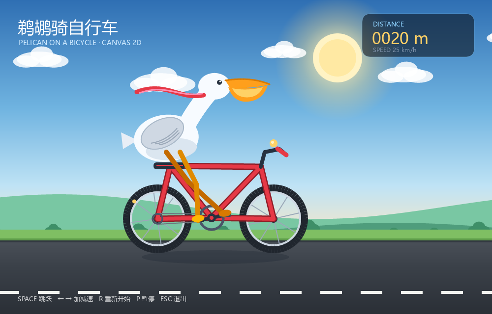

# 鹈鹕骑自行车（Canvas 2D）

一只骑自行车的鹈鹕，**整幅画都画在一块 `<canvas>` 上**：天空是线性渐变、太阳是径向
渐变、路面也是渐变，车轮/鹈鹕由 `arc`、`ellipse`、贝塞尔曲线和 `roundRect` 组成，
HUD 用 `fillText`，路面的中线用 `setLineDash` + `lineDashOffset` 跟着车速滚动。

```
examples/gui/pelican-canvas/main.ts             原生宿主：开窗、加载文档、打印校验报告
examples/gui/pelican-canvas/scene.js            画面、模拟、输入与帧循环（浏览器/原生共用）
examples/gui/pelican-canvas/index.html          文档：1000x640 的 <canvas> + <script src="scene.js">
examples/gui/pelican-canvas/xbintsc.config.json 入口 + gui 扩展，无需命令行开关
examples/gui/pelican-canvas/preview.png         运行效果预览
```



## 在浏览器里直接打开

直接双击打开 [`index.html`](index.html) 就能看、能玩，**不需要构建、服务器或打包器**。
`index.html` 用一个普通的 `<script src="./scene.js">` 加载全部逻辑，浏览器按经典脚本执行。

同一份 `scene.js` 也是原生程序的逻辑来源：xbintsc 的 gui `.html` 加载器会读取这个
`<script src>`，把脚本体 AOT 编译进二进制，在原生窗口里运行（没有 JS 引擎）。所以
`main.ts` 只负责开窗和报告，画面/输入/循环只有一份代码。

浏览器控制台里可以直接调：

```js
window.__pelicanCanvas.info()      // 画布尺寸、帧数、速度、距离
window.__pelicanCanvas.jump()      // 跳一下
window.__pelicanCanvas.state       // 当前模拟状态
```

`Esc` 在原生窗口里会退出；普通浏览器标签页不允许脚本随便关闭，所以浏览器里 `Esc` 被忽略。

## 构建与运行

需要 clang ≥ 16。Windows 上用 Visual Studio 自带的 LLVM clang 即可（无需开发者命令
提示符，它会自行找到 MSVC/SDK 的头文件和库）：

```bat
set xbintsc_CLANG=C:\Program Files\Microsoft Visual Studio\2022\Community\VC\Tools\Llvm\x64\bin\clang.exe
npx tsx src/cli/main.ts build examples/gui/pelican-canvas/main.ts
examples\gui\pelican-canvas\build\main.exe
```

或者直接编译并运行：

```bat
npx tsx src/cli/main.ts run examples/gui/pelican-canvas/main.ts
```

窗口会一直开着，直到你关闭它；设 `XT_GUI_AUTOCLOSE_MS=<毫秒>` 可以让引擎到点自动
关窗（无头冒烟测试用的就是这个模式）。`xbintsc.config.json` 里打开了 `app.console`，
所以 Windows 上报告也能打到控制台。

### 控制

`Space`/`↑` 跳跃 · `→` 加速 · `←` 刹车 · `R` 重新开始 · `P` 暂停 · `Esc` 退出原生窗口。

## 用到了哪些 Canvas API

| 类别 | API |
| --- | --- |
| 状态 / 变换 | `save`/`restore`、`translate`、`rotate`、`getTransform` |
| 颜色 | `fillStyle`/`strokeStyle`（纯色与 `CanvasGradient`）、`globalAlpha` |
| 渐变 | `createLinearGradient`、`createRadialGradient`、`addColorStop` |
| 路径 | `beginPath`、`moveTo`、`lineTo`、`arc`、`ellipse`、`quadraticCurveTo`、`bezierCurveTo`、`closePath`、`fill`、`stroke` |
| 矩形 | `clearRect`、`fillRect`、`roundRect` |
| 线段 | `lineWidth`、`lineCap`、`lineJoin`、`miterLimit`、`setLineDash`、`getLineDash`、`lineDashOffset` |
| 文本 | `font`、`textAlign`、`textBaseline`、`fillText`、`measureText`（HUD 布局） |

其中不少是这次为了让这个例子画得出来而补上的标准 API：渐变、`ellipse`、`roundRect`、
`lineCap`/`lineJoin`/`miterLimit`、`setLineDash`/`getLineDash`/`lineDashOffset` 和
`getTransform`。实现分布在：

- `runtime/ext_gui/canvas_gradient.cpp` —— 线性/径向渐变与色标；
- `runtime/ext_gui/canvas_style.cpp` —— 颜色、字体、线宽/端点/连接/虚线状态解析；
- `runtime/ext_gui/canvas_stroke.cpp` —— 描边几何（端点、斜接/圆角/斜切连接、虚线切分）；
- `runtime/ext_gui/canvas_raster.cpp` —— 每个像素按逆变换采样渐变；
- `runtime/ext_gui/dom_api_canvas_extra.cpp` —— 新增 API 的 DOM 绑定。

同时修了一个被这个例子暴露出来的变换顺序 bug：`ctx.translate(x, y); ctx.rotate(a)`
以前得到 `R * T`（旋转把平移也转走了，车轮会飞到天上），现在按 canvas 规则后乘，得到
`T * R`（围绕平移后的原点旋转）。

完整的支持清单与限制见 [`doc/gui/canvas.md`](../../../doc/gui/canvas.md#supported-api)；
仍未实现的主要有 `clip()`、阴影、`createPattern`、`globalCompositeOperation`、
`putImageData`/`createImageData`、`isPointInPath`、`toDataURL` 与 `OffscreenCanvas`。

## 一次真实运行的报告

`main.ts` 在第一个呈现帧通过 `window.__pelicanCanvas` 的 hooks 打印 `label=value` 行，
其中 `pixel-*` 是直接读回画布像素的校验点（天空、太阳、路面、鹈鹕、车轮、标题），所以
“画出来了”不是靠肉眼判断：

```
window=1000x640 (gui extension, SDL_GPU)
gpu=vulkan
canvas-box=x=0 y=0 1000x640
canvas-size=1000x640
frames=1
state=speed=... distance=... airborne=false
paint-shapes=2
pixel-sky=82,148,204,255
pixel-sun=...
pixel-road=45,51,58,255
pixel-pelican=...
pixel-wheel=...
pixel-title=255,255,255,255
gui closed
gui exited
```

`canvas-box` 来自布局（canvas 按 `width`/`height` 属性参与布局），`canvas-size` 是位图
尺寸，`pixel-*` 证明光栅器真的把渐变、路径和文字写进了像素。`gpu=vulkan` 是 SDL_GPU
在这台机器上选的后端（也会是 `d3d12` 或 `metal`）。

## 如果改动了引擎

`gui` 扩展是预编译的 `runtime/lib/<平台>/gui.lib`（或 `gui.a`）。改完
`runtime/ext_gui/*.cpp` 后要重新构建它，否则示例链接的还是旧引擎：

```bat
set xbintsc_CLANG=C:\Program Files\Microsoft Visual Studio\2022\Community\VC\Tools\Llvm\x64\bin\clang.exe
npm run gui
npx tsx src/cli/main.ts build examples/gui/pelican-canvas/main.ts --force
```

## 相关文档

- [doc/gui/canvas.md](../../../doc/gui/canvas.md) —— Canvas 2D 的完整 API 与光栅化模型
- [doc/gui.md](../../../doc/gui.md) —— GUI 扩展总览与里程碑
- [doc/ai/extensions.md](../../../doc/ai/extensions.md) —— `gui` / `node` 扩展
- [examples/gui/pelican-bike](../pelican-bike/README.md) —— 同一题材，用 HTML/CSS 盒子
- [examples/gui/pelican-svg](../pelican-svg/README.md) —— 同一题材，用 SVG 矢量图
